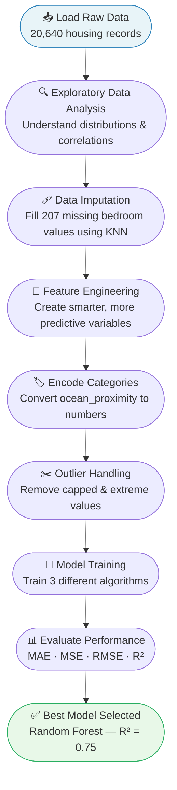
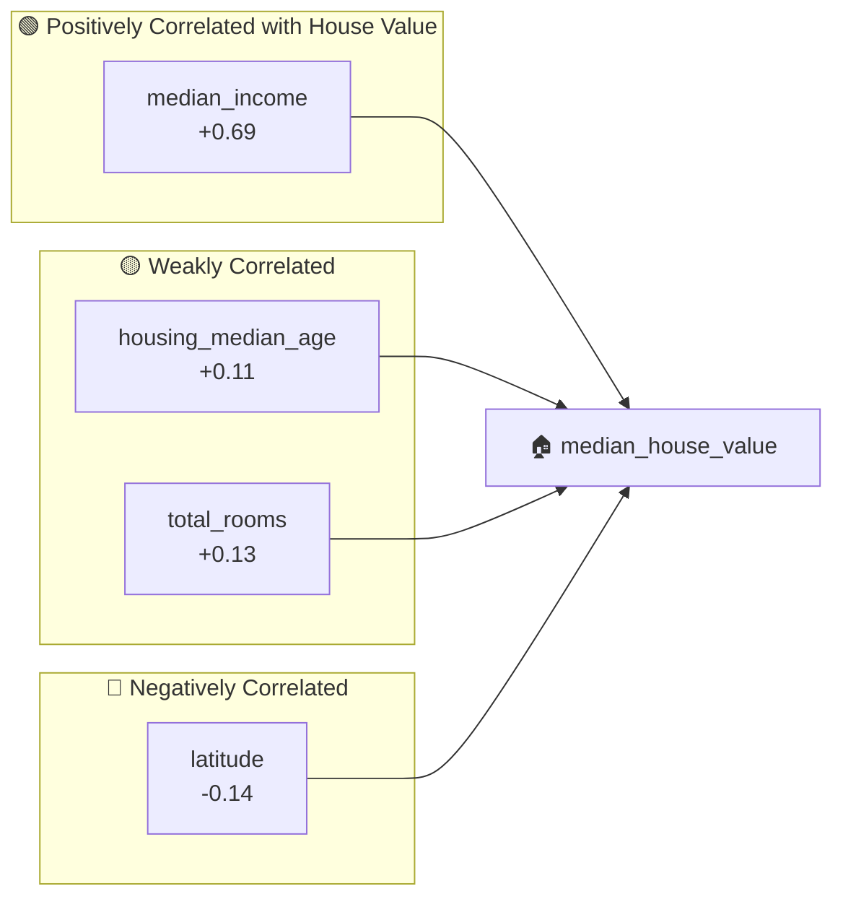
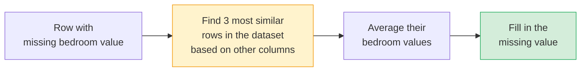
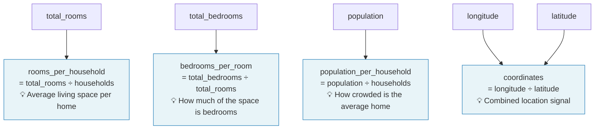
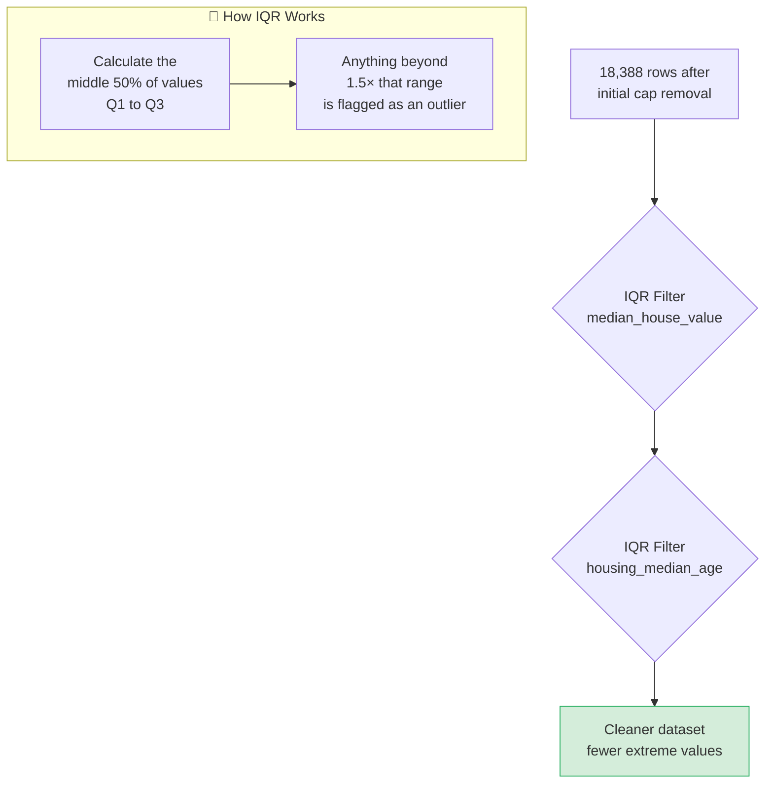
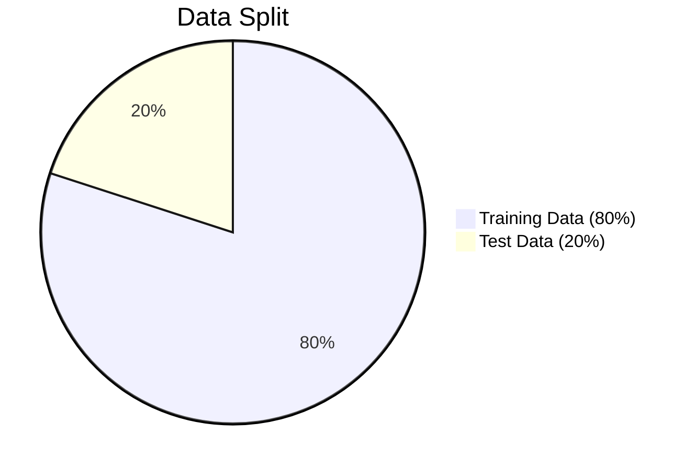
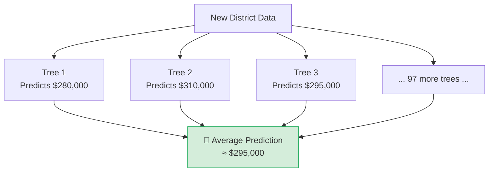

# 🏡 California Housing Price Prediction Model

> A data science project built to help property industry clients understand and predict residential house prices — using real-world census data, smart data preparation, and a series of increasingly powerful machine learning models.

---

## 📌 Table of Contents

- [Project Background](#-project-background)
- [What Problem Are We Solving?](#-what-problem-are-we-solving)
- [Project Workflow Overview](#-project-workflow-overview)
- [The Dataset](#-the-dataset)
- [Step 1 — Exploratory Data Analysis (EDA)](#-step-1--exploratory-data-analysis-eda)
- [Step 2 — Data Imputation (Filling in the Gaps)](#-step-2--data-imputation-filling-in-the-gaps)
- [Step 3 — Feature Engineering](#-step-3--feature-engineering)
- [Step 4 — Encoding Categorical Data](#-step-4--encoding-categorical-data)
- [Step 5 — Outlier Handling](#-step-5--outlier-handling)
- [Step 6 — Model Training & Results](#-step-6--model-training--results)
- [Model Performance Summary](#-model-performance-summary)
- [Business Value & Takeaways](#-business-value--takeaways)
- [Tech Stack](#-tech-stack)

---

## 📋 Project Background

This project was developed in response to a brief from a client operating in the **property and real estate sector**. The client provided a dataset containing housing census information from California, and the goal was to build a model capable of **predicting the median house value** of a given district based on a range of measurable factors.

The ability to estimate property values accurately — even at a neighbourhood or district level — has significant commercial value: from advising buyers and sellers, to supporting investment decisions, pricing strategies, and portfolio risk assessments.

---

## ❓ What Problem Are We Solving?

> *"Given what we know about a neighbourhood — its location, income levels, housing age, and population density — can we reliably predict what the median house price will be?"*

A property business might want to answer questions like:

- Which areas are likely to see higher property values?
- Is a property priced fairly relative to its neighbourhood characteristics?
- What factors drive house prices up or down the most?
- Can we automate valuations at scale to reduce reliance on manual appraisals?

This model addresses all of these by learning patterns from historical data and producing a **predicted median house value** for any district.

---

## 🗺 Project Workflow Overview

The project follows a structured data science pipeline. Each stage feeds into the next:



---

## 📦 The Dataset

The dataset was sourced from the **1990 California Housing Census** and contains **20,640 records**, each representing a census block (a small geographic district). It includes the following information:

| Column | What It Means |
|---|---|
| `longitude` / `latitude` | Geographic coordinates of the district |
| `housing_median_age` | Median age of homes in the district |
| `total_rooms` | Total number of rooms across all homes |
| `total_bedrooms` | Total number of bedrooms *(207 missing values)* |
| `population` | Number of people in the district |
| `households` | Number of households |
| `median_income` | Median household income (scaled units) |
| `median_house_value` | **Our target — the value we want to predict** |
| `ocean_proximity` | Categorical label: how close the district is to the ocean |

---

## 🔍 Step 1 — Exploratory Data Analysis (EDA)

Before building anything, we need to understand the data. EDA is the process of visualising and summarising the dataset to spot patterns, anomalies, and relationships.

### What We Looked At

**Distribution of each variable** — a histogram for every column tells us:
- Are values skewed or normally spread?
- Are there suspicious spikes at round numbers? (e.g. `housing_median_age` is capped at 52 and `median_house_value` is capped at $500,001 — artificial limits in the data)

**Correlation heatmap** — a grid showing how strongly each variable relates to every other:



### Key Insight
**`median_income` is by far the strongest single predictor of house value** — districts where people earn more tend to have much higher property prices. This is intuitive and gives us early confidence that the model has meaningful signal to learn from.

Also notable: `longitude` and `latitude` have a **−0.92 correlation with each other**, meaning they carry very similar geographic information. We later combine them into a single variable.

---

## 🩹 Step 2 — Data Imputation (Filling in the Gaps)

### The Problem
The `total_bedrooms` column had **207 missing values** — roughly 1% of the dataset. Dropping those rows entirely would lose real data. Filling them with a simple average would be inaccurate.

### The Solution: KNN Imputation
We used a technique called **K-Nearest Neighbours (KNN) Imputation**. Instead of guessing with a blanket average, this method:



> **Why this matters for the business:** Imputing intelligently rather than crudely means we keep a fuller, more accurate dataset. Better data in = better predictions out.

---

## 🔧 Step 3 — Feature Engineering

Raw columns don't always tell the most useful story. Feature engineering is the process of **creating new variables** from existing ones that are more meaningful to the model.

### Why Raw Totals Are Misleading

A district with 10,000 total rooms sounds large — but if it has 5,000 households, that's 2 rooms per household. A district with 500 total rooms but only 50 households also averages 10 rooms each. The raw number alone is misleading without context.

### New Features Created



### Columns Removed After Engineering
Once the engineered features were created, the original raw columns they were derived from were **dropped** to reduce noise and redundancy:

`latitude`, `longitude`, `total_bedrooms`, `total_rooms`, `households`, `population`

> **Why this matters:** Cleaner, more meaningful features help the model focus on the patterns that actually drive house prices — not noisy raw totals.

---

## 🏷️ Step 4 — Encoding Categorical Data

Machine learning models work with numbers, not text. The `ocean_proximity` column contained 5 text categories:

| Category | Count |
|---|---|
| `<1H OCEAN` | 9,136 |
| `INLAND` | 6,551 |
| `NEAR OCEAN` | 2,658 |
| `NEAR BAY` | 2,290 |
| `ISLAND` | 5 |

### One-Hot Encoding
We used a method called **one-hot encoding**, which converts each category into its own yes/no (1/0) column:

```
ocean_proximity_<1H OCEAN  | ocean_proximity_INLAND | ocean_proximity_ISLAND | ...
          0                |           0            |           0            |  ...
          1                |           0            |           0            |  ...
```

This avoids implying any false ordering between categories (e.g. that "ISLAND" is *greater than* "INLAND").

---

## ✂️ Step 5 — Outlier Handling

### Why Outliers Are a Problem
Outliers are extreme data points that can skew the model's learning. In this dataset, two artificial caps existed in the raw data:

- `housing_median_age` — capped at **52 years** (any home older than 52 was just recorded as 52)
- `median_house_value` — capped at **$500,001** (any home worth more was recorded as $500,001)

These aren't real values — they're data collection artefacts. Including them teaches the model the wrong lesson.

### Two-Stage Removal



> **Why two stages?** Cap removal handles known data artefacts. IQR handles genuinely anomalous values that could unfairly skew the model.

**Impact on model accuracy:** Removing outliers improved R² from **0.52 → 0.60** — a meaningful jump in predictive power just from cleaner data.

---

## 🤖 Step 6 — Model Training & Results

Three different algorithms were trained and compared. Think of each as a different strategy for learning the relationship between the input features and house prices.

### The Train/Test Split

Before training, the data was split:



The model only ever sees the **training data** during learning. The **test data** is held back and used to simulate real-world predictions — checking whether the model can generalise beyond what it was trained on.

---

### Model 1 — Linear Regression (Baseline)

**What it does:** Draws the best possible straight line through the data. Simple, fast, and interpretable.

**Analogy:** Like fitting a ruler to a scatter of dots — it finds the single straight line that comes closest to all points.

| Metric | Before Outlier Removal | After Outlier Removal |
|---|---|---|
| MAE | $54,486 | $41,326 |
| RMSE | $79,707 | $54,665 |
| R² | 0.52 | **0.60** |

**Limitation:** House prices don't follow a perfectly straight line. Many factors interact in complex, non-linear ways (e.g. income has a disproportionately large effect at higher levels). A straight line can only capture so much.

---

### Model 2 — Polynomial Regression (Adding Curves)

**What it does:** Extends linear regression by allowing the model to learn curved relationships. A degree-2 polynomial can fit a parabola rather than just a straight line.

**Analogy:** Instead of fitting a ruler, you're fitting a curved piece of flexible wire.

| Metric | Result |
|---|---|
| MAE | $38,220 |
| RMSE | $55,874 |
| R² | **0.58** |

**Observation:** Interestingly, polynomial regression did *not* improve significantly over linear regression after outlier removal. This suggests that the data's non-linearity is more complex than a simple curve — which motivates the third model.

---

### Model 3 — Random Forest Regressor (Best Performer) ✅

**What it does:** Trains a large number of independent decision trees (100 in this case), each learning slightly different patterns from random subsets of the data. The final prediction is the **average** across all trees.

**Analogy:** Instead of asking one expert, you ask 100 different analysts who each studied different parts of the data — and you take the consensus answer. No single analyst's blind spot dominates the outcome.



| Metric | Result |
|---|---|
| MAE | $30,409 |
| RMSE | $43,455 |
| R² | **0.75** |

---

## 📊 Model Performance Summary

| Model | MAE | RMSE | R² | Notes |
|---|---|---|---|---|
| Linear Regression (raw data) | $54,486 | $79,707 | 0.52 | Starting baseline |
| Linear Regression (cleaned) | $41,326 | $54,665 | 0.60 | +8 pts from cleaning alone |
| Polynomial Regression | $38,220 | $55,874 | 0.58 | Marginal improvement |
| **Random Forest** | **$30,409** | **$43,455** | **0.75** | Best model |

### How to Read These Metrics

```
R²  (R-squared)  → How much of the price variation our model explains.
                   0 = useless, 1 = perfect. 0.75 = explains 75% of variation.

MAE (Mean Absolute Error) → On average, how far off is each prediction?
                            $30,409 means we're typically within ~$30K of the real price.

RMSE (Root Mean Squared Error) → Like MAE but penalises large errors more.
                                  Useful for spotting if occasional big misses are a problem.
```

---

## 💼 Business Value & Takeaways

### What This Model Delivers

1. **Automated valuation at scale** — rather than manually appraising each district, the model can instantly generate price estimates for thousands of areas using available data.

2. **Income is the #1 driver** — `median_income` is the strongest predictor. This validates the intuition that purchasing power in a neighbourhood largely determines property values, and it's a signal property businesses should weight heavily in their own analysis.

3. **Location matters, but not in isolation** — proximity to the ocean and geographic coordinates are meaningful signals, but they don't override income effects.

4. **Data quality pays off** — the jump from R² 0.52 → 0.75 came almost entirely from better data preparation (imputation, feature engineering, outlier removal), not just switching algorithms. Clean data is the foundation.

5. **The model explains 75% of house price variation** — the remaining 25% is likely driven by factors not in this dataset (property condition, school quality, local amenities, market timing), which is a natural next step for improvement.

### Potential Next Steps for the Client

- Incorporate additional data sources (e.g. school ratings, crime statistics, proximity to transport)
- Retrain on more recent data — this dataset is from 1990 census
- Build a lightweight scoring tool that agents or analysts can use in practice
- Explore gradient boosting models (XGBoost, LightGBM) which often outperform Random Forest on tabular data

---

## 🛠 Tech Stack

| Tool | Purpose |
|---|---|
| `Python` | Core programming language |
| `Pandas` | Data loading, manipulation, and cleaning |
| `NumPy` | Numerical operations |
| `Scikit-learn` | Imputation, scaling, model training, evaluation |
| `Matplotlib / Seaborn` | Data visualisation |
| `Jupyter Notebook` | Interactive development environment |

---

> *Built as part of a client-scoped data science project. Dataset: California Housing Census (1990). Goal: Predict district-level median house values to support property market decision-making.*
